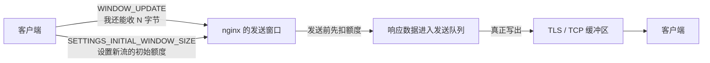
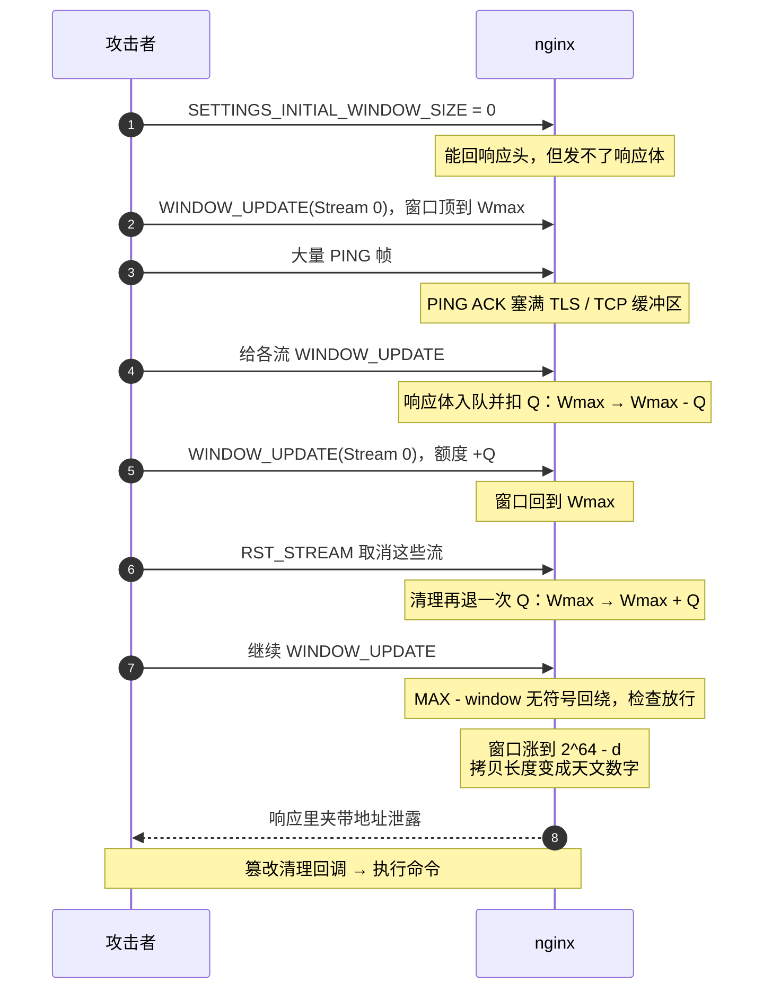
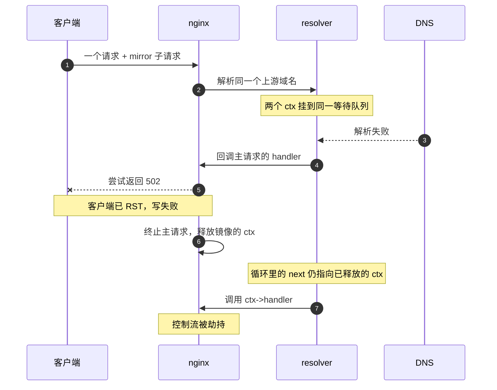
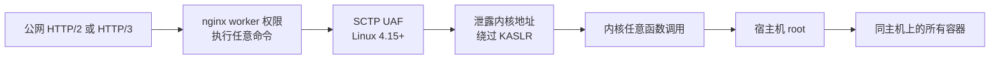
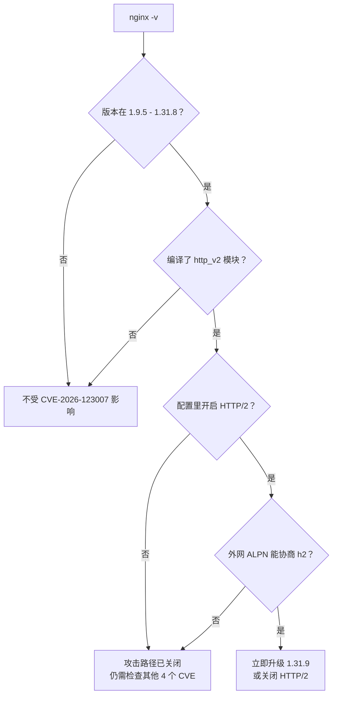
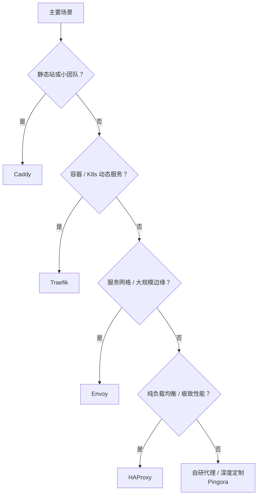

## 前言

2026 年 11 月，安全团队 Xint 公布了代号 **nginx2root** 的一组漏洞：5 个 nginx 远程代码执行漏洞，外加 1 个可以配合使用的 Linux 内核提权漏洞。其中影响面最大的 **CVE-2026-123007**，只需要目标开启了 HTTP/2，攻击者不用登录、不用任何凭据，就能在 nginx 工作进程的权限下执行命令；再配合内核漏洞，可以从容器里一路打到宿主机 root。

更扎心的是：这段有问题的代码从 2015 年 nginx 1.9.5 引入 HTTP/2 时就存在，一直到 1.31.8，整整十一年没人发现。

这篇文章不打算复述漏洞报告，而是想回答三个问题：

1. 这个漏洞到底是怎么发生的？（尽量说人话）
2. 我该怎么判断自己的服务有没有中招，怎么处置？
3. 如果因此想换掉 nginx，有哪些靠谱的平替，各自适合什么场景？

## 一、nginx2root 是什么

它不是一个漏洞，而是一组漏洞的合称。5 个 nginx 漏洞彼此独立，**不需要组合**，只是触发条件不同：

| CVE | 触发条件 | 关掉 HTTP/2 能挡吗 |
| --- | --- | --- |
| CVE-2026-123007 | 开启 HTTP/2 | ✅ |
| CVE-2026-123634 | 使用 `resolver` + 请求里带变量的 `proxy_pass` + `mirror`（且 `mirror_request_body off`） | ❌ |
| CVE-2026-123633 | 开启 HTTP/2，且请求被转发到上游（反向代理） | ✅ |
| CVE-2026-121810 | 开启 HTTP/3，且请求被转发到上游 | ❌ |
| CVE-2026-113425 | 邮件代理开启 `proxy on` 并配置 `auth_http` | ❌ |
| Linux 内核 SCTP 漏洞 | 能加载 SCTP 模块（多数发行版默认如此） | — |

修复版本是 **nginx 1.31.9**（官方计划 2026 年 11 月 18 日发布；实际可用状态请以官方 release notes 和你所用发行版的安全公告为准）。

影响面有多大？按 Shodan 在 2026 年 11 月 10 日的数据，`product:nginx` 有 5670 万台主机，其中能识别出版本的约 1194 万台，而这 1194 万里 **98.9% 落在受影响版本区间**。当然，这只是一个上界，因为还需要 HTTP/2 真正开启、且没有打上发行版的热修复补丁，不能直接当成"1194 万台可被攻陷"。

但无论如何，nginx 的部署量摆在那里，这个漏洞的潜在影响是"互联网基础设施级"的。

## 二、先补课：HTTP/2 的流量控制

要理解 CVE-2026-123007，得先知道 HTTP/2 的**流量控制（flow control）**。

HTTP/2 在一条 TCP 连接上跑很多个"流（stream）"，每个流是一对请求/响应。为了避免服务端往一个慢客户端猛灌数据，HTTP/2 设计了"窗口"机制：

- 每个流有一个发送窗口；
- 整条连接还有一个共享的发送窗口；
- 窗口里的数字表示"我还能给你发多少字节"；
- 服务端每发一段数据，就从窗口里扣掉相应长度；
- 客户端如果想继续收，就发一个 `WINDOW_UPDATE` 帧，把窗口加回去。

可以把它想成奶茶店的取餐额度：店员每做一杯就从额度里扣一杯，顾客说"我还能再喝 10 杯"，额度就加 10。正常情况下，额度永远在 0 到某个上限之间。

HTTP/2 规定的默认窗口是 65535 字节，上限是 `0x7fffffff`（约 2GB）。问题就出在"退款"和"加额度"这两件事上。



## 三、主角 CVE-2026-123007：一笔被记了两次的账

### 1. 正常记账逻辑

nginx 发送响应数据时，会先把数据放进内存里的发送队列，同时做两件事：

```c
h2c->send_window -= frame_size;     // 连接级窗口扣掉
stream->send_window -= frame_size;  // 流级窗口也扣掉
```

如果这个流在数据真正发出去之前被客户端取消了（`RST_STREAM`），nginx 的清理逻辑会把这段没发出去的数据"退"回连接级窗口：

```c
h2c->send_window += window;
```

单看每一步都没问题：**扣额度、退额度，天经地义**。漏洞出在"扣"和"退"之间还夹了一步。

### 2. 第一步：把货先压在仓库里

攻击者希望有一批数据"已经扣了额度，但还没真正发出去"。怎么做到？

- 先把连接的发送窗口顶到上限；
- 通过 `SETTINGS_INITIAL_WINDOW_SIZE = 0` 告诉 nginx："新流的窗口是 0"，于是 nginx 能回响应头，但发不了响应体；
- 客户端停止读取，再狂发 PING 帧。nginx 会优先回复这些控制帧，把 TLS / TCP 的发送缓冲区塞满；
- 这时再给每个流发 `WINDOW_UPDATE`，nginx 就会把响应体排进队列、扣掉额度，但因为底层缓冲区满了，数据一直压着发不出去。

设这批积压的数据总量为 `Q`。此时连接窗口的变化是：

```text
Wmax  ->  Wmax - Q
```

### 3. 第二步：同一笔额度退两次

接下来攻击者做两件事：

1. 对 Stream 0 发一个 `WINDOW_UPDATE`，给连接窗口加 `Q`；
2. 对刚才那些流发 `RST_STREAM` 取消它们。

第一步让窗口回到 `Wmax`；第二步触发清理逻辑，把那批没发出去的数据额度再"退"一次，又加了 `Q`：

```text
Wmax - Q  ->  Wmax  ->  Wmax + Q
```

一笔钱，先以"加额度"的名义记了一次，又以"退款"的名义记了一次，账面上凭空多出 `Q`。**这就是漏洞的核心：重复记账，而且退款这一步没做上限检查。**

### 4. 第三步：负数变成天文数字

窗口超过了上限，本来应该被拒绝。nginx 的检查逻辑是这样的：

```c
if (window > NGX_HTTP_V2_MAX_WINDOW - h2c->send_window) {
    return ngx_http_v2_connection_error(h2c, NGX_HTTP_V2_FLOW_CTRL_ERROR);
}
```

数学上没问题：剩余容量 = 上限 - 当前值。但 `h2c->send_window` 是无符号类型 `size_t`。当当前值已经超过上限时：

```text
MAX - (MAX + Q) = -Q
```

在无符号运算里，`-Q` 不会变成负数，而是回绕成一个巨大的正数（64 位下接近 1.8 × 10¹⁹）。于是检查看到"剩余容量还很大"，继续放行 `WINDOW_UPDATE`。攻击者可以把这个窗口加到任意 64 位值。

这就像水表倒着走：本来读到 `-1` 应该报警，但表盘只会显示 `18446744073709551615`，系统以为你还有用不完的水。

### 5. 第四步：从天文数字到"一小段越界拷贝"

窗口被加到比如 `2^64 - d` 之后，同一个 64 位二进制，换个类型解释就变了味：

- 按无符号 `size_t` 看：天文数字，好像还能发无数数据；
- 按有符号 `off_t` 看：一个很小的负数 `-d`。

nginx 接下来要算这一轮能发多少数据：

```c
if (limit == 0 || limit > (off_t) h2c->send_window) {
    limit = h2c->send_window;
}
if ((off_t) frame_size > limit) {
    frame_size = (size_t) limit;
}
```

正常的 `frame_size` 是正数，当然大于 `-d`，于是 `frame_size` 被赋成了 `-d`；再转回 `size_t`，又变回 `2^64 - d`。这个值一路传到设置缓冲区指针的地方：

```c
chunk->last = chunk->pos + size;  // size 是 -d
```

结果 `last` 跑到 `pos` **前面**去了。后面 TLS 输出路径用 `last - pos` 当拷贝长度，在有符号视角是 `-d`，传给 `memcpy()` 时又变成 `2^64 - d`。

### 6. 第五步：本该立刻崩溃，为什么没有？

按理说，拷贝接近 `2^64` 字节会瞬间越过堆边界，工作进程直接段错误。但 glibc 在 x86-64 上的 `memcpy` 实现救（也害）了它：

- 它不是从前往后老老实实拷，而是先加载源地址的头和尾，再从**目标地址的末尾往前**倒着拷；
- 目标末尾是 `dest + size`，而 `size = 2^64 - d`，这个加法在 64 位地址空间里溢出，绕回到 `dest - d`；
- 于是"末尾"跑到了"开头"前面，倒序循环只跑一轮就结束。

最终实际被拷贝的只有两小段：开头 128 字节，以及末尾附近的 160 字节。一个本该崩溃的巨型越界，被"缩"成了一次**精准的小范围越界写**。

### 7. 第六步：泄露地址 + 改函数指针 = 执行命令

攻击者要利用这 160 字节做两件事：

- 前面 96 字节覆盖 TLS 明文缓冲区**前面**的堆元数据；
- 后面 64 字节是 nginx 镜像和堆上的指针，会随着响应一起发回给攻击者，完成**地址泄露**（绕过 ASLR）。

为了把 `src` 放到可控的位置，攻击者用 `Range` 请求让 nginx 构造 multipart 响应，边界字符串正好分配在请求内存池里；再用多个 `Cookie` 头控制那 160 字节的内容和布局。拿到地址泄露、改掉堆元数据之后，就可以进一步覆盖一个清理回调的函数指针，在回调触发时执行任意命令。

整个链路可以浓缩成一句话：

> **重复记账 → 窗口越界 → 无符号回绕绕过检查 → 有符号/无符号转换制造巨大拷贝长度 → glibc 倒序拷贝把它变成可控的小越界 → 泄露地址 + 篡改函数指针 → RCE。**



### 8. 为什么能藏十一年？

因为每一步单独看都"合法"：扣额度是对的，退额度是对的，无符号回绕是语言特性，`memcpy` 的倒序实现是性能优化。只有把它们串成一条链，才构成漏洞。这类 bug 靠人工审计极难发现，而自动化工具 + 模糊测试 + AI 辅助代码审计，正在把这类"深水区"问题一批批挖出来。Xint 也提到，2026 年还没过完，nginx 安全公告列表已经记录了 26 个漏洞，而 2025 年全年只有 2 个。

## 四、另外四个漏洞：都是"释放后使用"

剩下 4 个 nginx 漏洞属于同一大类：**Use-After-Free（UAF，释放后使用）**。

用大白话讲：酒店房间已经退租、清洁工都进去打扫了，但你的房卡还能刷开这扇门。程序把一块内存释放了，却还有代码拿着旧指针去读写它。如果攻击者能抢在这块内存被重新分配时填入自己的数据，就能让程序"按照攻击者的剧本"继续执行，最终劫持控制流。

### CVE-2026-123634：DNS 等待队列里的"幽灵"

nginx 作为反向代理时，可以用 `proxy_pass http://$host;` 这种写法，把请求里的域名拿去做 DNS 解析。解析是异步的，nginx 会把等待同一个域名的请求挂到一条"等待队列"上。

配合 `mirror` 指令（把请求复制一份打到测试环境），主请求和镜像请求可能挂在同一个 DNS 节点上等待。关键剧情是：

1. DNS 解析失败，主请求准备返回 502；
2. 客户端此时把 TCP 连接重置了，502 写不出去，nginx 决定终止整个请求；
3. 终止时的清理逻辑顺手把**镜像请求**的 resolver 上下文也释放了；
4. 但 resolver 的循环还拿着指向它的 `next` 指针，继续"叫号"，于是操作了已经释放的内存。

如果攻击者能控制这块被复用的内存，就能控制 `next` 和 `handler`，最终让 nginx 调用 `system()` 之类的函数。



### CVE-2026-123633：车位不够时，拖走了正在上车的车

nginx 每个 worker 的连接槽位是固定的（`worker_connections`），客户端连接和上游连接共享这些槽位。槽位紧张时，nginx 会"回收"一些看起来空闲的连接，这叫 draining。

问题在于：一个 HTTP/2 连接如果正好读到一半帧（`incomplete`），会被错误地标记为"可回收"，并且没有及时从可回收队列里摘掉。等这个连接上的请求去连上游、需要新槽位时，draining 可能把它**自己所在的连接**给回收了：

- 连接被关闭 → 请求内存池被销毁 → 请求结构 `r` 和上游结构 `u` 都没了；
- 但上游连接代码还在继续用 `r` / `u`，典型的 UAF。

攻击者可以通过堆布局让上游地址被改写成自己的服务器，先拿到地址泄露，再用一个伪造的请求把读回调换成 `execv()`，从而执行命令。

### CVE-2026-121810：HTTP/3 版本的同一类问题

HTTP/3 跑在 QUIC 上，一条 QUIC 连接承载多个请求流。nginx 给每个流也分配连接槽位。创建新流时，代码会先把父 QUIC 连接从"可回收队列"里拿出来，等槽位分配完再放回去——但新流此时还没挂进父连接的流树。

如果这个空档里发生 draining，父连接可能被判定为"可以关闭"，把正在创建/正在连上游的请求一起带走，同样是 UAF。利用手法和上一个漏洞类似。

### CVE-2026-113425：邮件代理的认证连接

nginx 还能做 IMAP / POP3 / SMTP 的邮件代理。开启 `auth_http` 后，用户登录时 nginx 会去问一个 HTTP 服务"这个账号密码对不对"。

这里维护着两条连接：客户端连接和认证连接。客户端连接的写事件如果失败（比如客户端重置了连接），会关闭客户端连接并销毁它的内存池；但认证连接还开着，`data` 字段仍指向已经被释放的会话。等认证服务返回结果，nginx 顺着这个悬空指针继续用，就形成了 UAF。攻击者可以用 IMAP 命令的内容去"占坑"，伪造出假的会话和回调，最终执行命令。

## 五、最后一环：Linux 内核 SCTP 漏洞

前面 5 个漏洞拿到的只是 **nginx worker 权限**。worker 通常是低权限用户，要真正控制整台机器，还需要提权。Xint 在 Linux 内核的 SCTP 子系统里找到了一个零日：

- SCTP 和 TCP 一样是面向连接的协议，连接叫"association（关联）"；
- 一个发送操作还在等待时，它的关联可以被转移到另一个 socket；
- 等待中的操作随后释放了这个已被转移的关联，造成 UAF 或 double free。

这个 bug 从 Linux 4.15（2018 年）就存在了，藏了 8 年多。利用它可以拿到内核内存泄露（绕过 KASLR）和任意函数调用，最终提权到 root。**在 Docker 容器里运行 nginx 也没用**：容器共享宿主内核，打到内核就等于打到宿主机和同一台机器上的所有容器。

临时缓解：如果主机不需要 SCTP，可以在 `/etc/modprobe.d/` 下加一行 `install sctp /bin/false` 阻止模块加载。注意这只防 `modprobe` 加载，不能卸载已经加载的模块，也管不了编译进内核的 SCTP。



## 六、自查：你的 nginx 中招了吗

一条条来，顺序很重要。



### 1. 看版本

```bash
nginx -v 2>&1
```

- `1.9.5` 到 `1.31.8`：官方发行版包含漏洞代码，继续往下查；
- `1.9.4` 及更早：还没有 HTTP/2，不受 CVE-2026-123007 影响；
- `1.31.9` 及以后：大概率已修复，但仍建议核对 release notes。

**特别注意发行版版本号。** Ubuntu 24.04 自带 1.24.0、Ubuntu 22.04 自带 1.18.0、Debian 12 自带 1.22.1，这些版本号看起来"很老"，但发行版可能已经把补丁 backport 回去了。反过来，光看 `nginx -v` 也判断不了是否已修复。要看完整包版本，比如 `1.18.0-6ubuntu14.22`，再对照发行版的安全公告。

### 2. 看有没有编译 HTTP/2 模块

```bash
nginx -V 2>&1 | grep -q -- '--with-http_v2_module' \
  && echo 'HTTP2_MODULE=present' \
  || echo 'HTTP2_MODULE=absent'
```

### 3. 看配置里有没有开 HTTP/2

```bash
sudo nginx -T 2>&1 \
  | sed 's/#.*//' \
  | grep -nE 'listen[[:space:]].*http2|^[[:space:]]*http2[[:space:]]+on[[:space:]]*;'
```

有输出（比如 `listen 443 ssl http2;` 或 `http2 on;`）就说明开了。

### 4. 从外网验证 HTTP/2 是否真的可达

```bash
openssl s_client -connect your.domain:443 -servername your.domain -alpn h2 </dev/null 2>&1 \
  | grep -E 'ALPN protocol:|No ALPN negotiated|Connection refused|connect:errno|handshake failure'
```

看到 `ALPN protocol: h2` 说明外网能协商 HTTP/2。如果前面有 CDN 或四层代理，还要直接对 nginx 本身再测一次。

### 5. 判定

| 结果 | 结论 |
| --- | --- |
| 未修复版本 + 有 HTTP/2 模块 + 外网能协商 h2 | **可利用且已暴露，立刻处理** |
| 未修复版本 + 有模块但 HTTP/2 已关闭 | 漏洞代码在，但当前攻击路径被堵住 |
| 1.9.4 以前 / 没有 HTTP/2 模块 | 不受该漏洞影响 |
| 1.31.9 或确认已 backport | 已修复 |

顺带检查三个"旁路"配置：`resolver` + 变量 `proxy_pass` + `mirror`（CVE-2026-123634）、HTTP/3 的 `quic` 监听（CVE-2026-121810）、邮件代理的 `auth_http`（CVE-2026-113425）。

## 七、处置清单

**第一优先级：升级到 1.31.9。** 升级后要 `systemctl restart nginx` 或做二进制热升级；只 `reload` 配置不会替换正在运行的可执行文件。

**暂时升不了级，就按配置关功能：**

```nginx
# 关 HTTP/2（1.25.1+）
listen 443 ssl;
http2 off;

# 关 HTTP/3 / QUIC
listen 443 ssl;
# listen 443 quic reuseport;
http3 off;
add_header Alt-Svc 'clear' always;

# 邮件代理只监听回环，或防火墙白名单
listen 127.0.0.1:143;
```

`mirror` 相关的场景，把 `proxy_pass` 指向固定的 upstream 组，避免请求期做 DNS 解析。

**排查是否已经被打过：**

- 看 443 上的长连接：同一外部 IP 持续很久、`bytes_received` 飞涨而 `bytes_sent` 很小；
- 给 access log 加上 `$connection`、`$connection_requests`、`$request_length`，对比"实际收到的字节"和"记录到的请求长度"；
- 用 auditd 监控 nginx worker 的 `execve`：正常 worker 不该启动外部程序；
- 看 error log 里的 worker 异常退出、段错误和 core dump。

**别忘了容器和内核。** 容器里的 nginx 被打穿后，SCTP 漏洞可以继续提权到宿主机。不需要 SCTP 的机器建议直接禁掉模块。

## 八、是时候重新看看 nginx 的平替了

说句公道话：nginx 依然是极其优秀、极其成熟的软件，这次漏洞也不是"nginx 不行了"。但这次事件暴露了两个现实：

1. **C 语言写的大型网络服务，内存安全问题的成本越来越高。** 一个十一年前的窗口计算疏忽，能直接变成未授权 RCE。
2. **"默认配置"不等于"安全配置"。** 很多人开 HTTP/2 只是为了性能，根本不知道它带来了一条新的攻击面。

所以如果你正在选型，或者本来就有迁移计划，下面这些方案值得认真评估。



### Caddy：省心程度的天花板

Go 写的 Web 服务器 / 反向代理，最大的卖点是**自动 HTTPS**：填个域名，证书申请、续期、HTTP→HTTPS 跳转全自动。配置文件（Caddyfile）短得不像话：

```caddyfile
blog.example.com {
    encode zstd gzip
    root * /srv
    file_server
}
```

它原生支持 HTTP/3、反向代理、负载均衡、静态文件、模板，插件生态也不错。Go 的内存安全特性和 GC 让"堆越界写"这类漏洞基本绝迹——注意，是"这类"，逻辑漏洞、SSRF、路径穿越依然可能存在，仍然要跟进安全更新。

本站现在用的就是它，配置大概长这样（省略了缓存头等细节）：

```caddyfile
{
    admin off
}

{$SITE_ADDRESS::80} {
    root * {$SITE_ROOT:/srv}
    encode zstd gzip

    @immutable path /_astro/*
    header @immutable Cache-Control "public, max-age=31536000, immutable"
    header {
        X-Content-Type-Options "nosniff"
        -Server
    }

    file_server
}
```

**适合：** 静态站、个人/中小团队服务、想要零运维 TLS 的场景。

**不适合：** 需要极复杂的动态配置、超大规模多租户网关（这时候该上 Traefik / Envoy）。

### Traefik：云原生场景的默认答案

同样是 Go 写的，Traefik 的核心是**服务发现**：它直接监听 Docker、Kubernetes、Consul、Nomad 的 API，容器起来自动生成路由，容器挂了自动摘除，不用改配置、不用 reload。

```yaml
# docker-compose 里给服务打标签即可
labels:
  - "traefik.enable=true"
  - "traefik.http.routers.blog.rule=Host(`blog.example.com`)"
  - "traefik.http.routers.blog.entrypoints=websecure"
  - "traefik.http.routers.blog.tls.certresolver=le"
```

中间件体系（限流、BasicAuth、转发认证、熔断、重试）也很完整，还自带 Dashboard。

**适合：** Kubernetes、Docker Swarm、微服务、需要频繁增减服务的环境。

**不适合：** 单机静态站（有点杀鸡用牛刀）、对极致单请求性能有执念的场景。

### Envoy：服务网格和大规模边缘的事实标准

C++ 写的 L7 代理，起源于 Lyft，现在是 CNCF 毕业项目、Istio 的数据平面。动态配置走 xDS 协议，支持 HTTP/2、HTTP/3、gRPC、mTLS、精细的流量切分、熔断、可观测性。

代价是**学习曲线陡峭**，配置文件（YAML）动辄几百行，通常由控制平面（Istio、Gloo、Emissary 等）生成，而不是手写。

**适合：** 服务网格、API 网关、大规模多集群流量治理。

**不适合：** 想十分钟内把一个静态站跑起来的人。

### HAProxy：纯粹、稳定、快

C 写的四层/七层负载均衡器，二十多年历史，性能口碑极佳，ACL 和健康检查非常灵活。很多公司的入口流量其实是 HAProxy + nginx 的组合。它也能做 TLS 终止和 HTTP/2，但静态文件服务、动态配置这些不是它的主场。

**适合：** 纯负载均衡、TCP 代理、对延迟和吞吐极其敏感的场景。

**不适合：** 需要自动证书、动态服务发现、丰富中间件的场景。

### Pingora：想自己造轮子的选择

Cloudflare 开源的 Rust 代理框架，支撑着他们家每天数万亿请求。它不是开箱即用的服务器，更像一套"代理开发框架"：你写 Rust 代码来定义路由、过滤、缓存、上游选择。Rust 的所有权模型能在编译期消掉一大类内存安全问题。

**适合：** 有研发能力、需要深度定制的团队。

**不适合：** 想要"改个配置文件就上线"的用户。

### 速查对比

| 方案 | 语言 | 最舒服的场景 | 需要留意 |
| --- | --- | --- | --- |
| nginx | C | 通用 Web 服务、反向代理、生态成熟 | 需持续打补丁；配置项多，容易踩坑 |
| Caddy | Go | 静态站、自动 HTTPS、单机/小团队 | 超大规模动态配置偏弱 |
| Traefik | Go | 容器 / K8s 动态服务发现 | 单机静态场景偏重 |
| Envoy | C++ | 服务网格、大规模边缘、gRPC | 学习成本高，通常要控制平面 |
| HAProxy | C | 高性能四层/七层负载均衡 | 动态服务发现需配合 DataPlane API |
| Pingora | Rust | 自研代理、深度定制 | 是框架不是成品 |
| Apache httpd | C | 传统生态、`.htaccess`、模块丰富 | 性能与配置风格偏老派 |
| Lighttpd | C | 轻量静态站、嵌入式 | 生态和资料相对少 |

另外提醒一句：**OpenResty、各种 nginx 衍生发行版同样包含这次受影响的代码**，不能因为它叫别的名字就掉以轻心；升级时要等上游把补丁合并进来。

### 迁移时最容易忽略的几件事

1. **TLS 不是换个软件就自动安全。** 协议版本、加密套件、HSTS、OCSP 都要重新确认一遍。
2. **反向代理的"信任边界"。** `X-Forwarded-For`、`X-Real-IP` 的处理方式各软件不同，别把伪造头直接传给后端。
3. **限流和超时。** nginx 的 `limit_req`、`proxy_read_timeout` 迁过去要重新映射，默认值不一定符合你的业务。
4. **缓存语义。** 静态资源的强缓存、HTML 的 revalidate，最好显式写清楚（Caddy 里用 `header` matcher，Traefik 里用 middleware）。
5. **回滚方案。** 新旧网关并行跑一段时间，用 DNS 或四层 LB 切流量，比直接替换稳妥得多。

## 九、总结

nginx2root 值得每个运维和开发认真对待，原因不只是"又一个 RCE"，而是它同时具备三个特征：

- **无需认证**，公网可达即可打；
- **影响版本极广**，十一年间的官方版本几乎全覆盖；
- **能链到内核提权**，容器也挡不住。

如果你只记三件事：

1. **查版本、查 HTTP/2/HTTP/3、查 backport**，别只看 `nginx -v`；
2. **能升级就升到 1.31.9，升不了就先关掉对应功能**，并且记得重启而不只是 reload；
3. **不需要 SCTP 的机器，把内核模块禁掉**。

至于要不要换掉 nginx：这不是一道"安全正确"的单选题。Caddy 和 Traefik 用内存安全的语言消掉了一整类漏洞，运维体验也更好；Envoy、HAProxy 在各自领域依然是标杆。选择的关键不是"哪个最安全"，而是**你的场景、团队能力和补丁响应速度**。

毕竟，没有不会出漏洞的软件，只有跟得上补丁的运维。

## 参考

- [NGINX2Root: New Remote Code Execution Vulnerabilities in nginx Require Urgent Patching — Xint](https://xint.io/blog/nginx2root-remote-code-execution)
- [nginx2root.com](https://nginx2root.com/)
- [nginx 1.31.9 Release Notes](https://github.com/nginx/nginx/releases#release-release-1.31.9)
- [Caddy 官方文档](https://caddyserver.com/docs/)
- [Traefik 官方文档](https://doc.traefik.io/traefik/)
- [Envoy 官方文档](https://www.envoyproxy.io/docs)
- [HAProxy 官方文档](https://docs.haproxy.org/)
- [Pingora (Cloudflare)](https://github.com/cloudflare/pingora)
